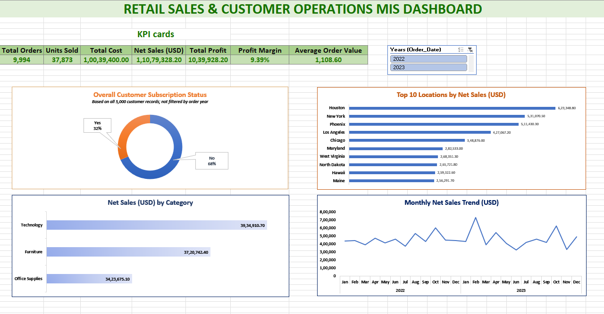

# Retail Sales & Customer Operations MIS Reporting System

An end-to-end **MIS reporting and retail analytics project** using
Microsoft SQL Server and Excel. The project validates and cleans
customer and order data, calculates sales and profitability KPIs,
answers business questions with SQL, and presents results in an Excel
MIS workbook and dashboard.

## Project Overview

-   **Tools:** SQL Server / SSMS, Microsoft Excel
-   **Analysis period:** January 2022 -- December 2023
-   **Raw data:** 5,050 customer rows and 9,994 order rows
-   **Clean data:** 5,000 customer records and 9,994 order records
-   **Analysis:** 15 business questions organised into eight SQL scripts

## Business Questions

-   How are sales, orders, quantity, and calculated profit performing?
-   Which months have the highest and lowest net sales?
-   Which categories, sub-categories, and products perform best?
-   How do discount levels relate to profit margin?
-   How do subscription groups, customer age groups, purchase frequency,
    and locations compare?
-   Which customer segment and shipping mode account for the most
    activity?
-   What data-quality exceptions need investigation?

## Tools and Skills

**SQL Server:** data validation, duplicate checks, NULL analysis,
cleaning, joins, aggregations, `GROUP BY`, `ORDER BY`, `CASE`, KPI
calculations, and exception reporting.

**Excel:** reporting tables, KPI summary, pivot-based analysis, charts,
year slicer, and management dashboard.

## Key KPIs

 | KPI                 |           Result|
  |---------------------| ---------------|
  Total Orders          |          9,994
  Total Quantity        |        37,873
  Gross Sales           |  11,485,170.00
  Discount Amount       |     405,841.80
  Net Sales             |  11,079,328.20
  Total Cost            |  10,039,400.00
  Calculated Profit     |   1,039,928.20
  Profit Margin         |          9.39%
  Average Order Value   |       1,108.60


## Excel Management Dashboard

The interactive Excel dashboard provides a consolidated view of key business KPIs, monthly sales trends, category performance, and profitability. A year slicer allows users to filter the dashboard by year.



## Excel Reporting

The Excel workbook includes the following reporting worksheets:

- `KPI_Summary` — Summary of key business performance indicators.
- `Monthly_MIS` — Monthly sales and performance reporting.
- `Sales_Performance` — Category, subcategory, and product performance analysis.
- `Location_Performance` — Location-level sales analysis.
- `Customer_Analysis` — Customer and subscription analysis.
- `Exception_Report` — Records flagged for data-quality or pricing exceptions.
- `Management_Dashboard` — Interactive dashboard for management reporting.

## SQL Analysis

SQL Server was used to validate the data and answer business questions related to:

- Overall sales and profitability
- Monthly sales performance
- Category and subcategory performance
- Product-level performance
- Customer and subscription analysis
- Segment and shipping-mode analysis
- Discount and profitability analysis
- Data-quality exceptions

## Key Findings

-   Technology generated the highest category net sales and calculated
    profit.
-   February 2023 had the highest monthly net sales: **731,638.80**.
-   June 2023 had the lowest monthly net sales: **328,939.00**.
-   Chairs had the highest sub-category net sales.
-   Higher discount groups showed lower observed profit margins in this
    dataset; this is an association, not proof of causation.
-   Standard Class was the most-used shipping mode.
-   507 orders with both cost price and list price equal to zero were
    retained and flagged for investigation.

## Data Quality and Methodology

The project preserves raw tables, removes exact duplicate copies from
the clean customer table, standardises equivalent category labels,
preserves unresolved missing customer values, and flags zero-price
orders rather than deleting them. SQL results were reconciled against
overall KPI totals.

**Limitations:** The dataset does not include delivery dates or
durations, so delivery speed and SLA performance are not measured. The
calculated profit is derived from the supplied price and cost fields and
is not audited accounting profit.

## Repository Structure

``` text
Retail-Sales-Customer-Operations-MIS/
├── README.md
├── Project_Documentation.md
├── sql/
├── results/
├── Retail_MIS_Reporting.xlsx
└── screenshots/
```

Folder names above describe the intended organisation; actual file names
may vary depending on the files uploaded.

## Files

-   **`Project_Documentation.md`** --- full project methodology,
    cleaning rules, KPI definitions, SQL analysis coverage, findings,
    reconciliation checks, and limitations.
-   **`sql/`** --- SQL Server analysis scripts.
-   **`results/`** --- exported CSV query results.
-   **`Retail_MIS_Reporting.xlsx`** --- Excel MIS report and management
    dashboard.

## Conclusion

This project demonstrates an end-to-end workflow from raw-data
validation and cleaning to SQL analysis and Excel MIS reporting, aligned
with entry-level MIS Analyst, Reporting Analyst, and Data Analyst
responsibilities.
